# Laporan lengkap: 5 terbang dengan gangguan otomatis (DIST_FLT 1 – 5)

L1 periode tetap 15 s, tanpa fuzzy, misi 3 waypoint. Tanggal uji: 15 November 2026.
Pembanding: terbang baseline 12:58 (tanpa gangguan, konfigurasi sama).
Data: `.tlog` Mission Planner (`.rlog` isinya identik), telemetri ~5 Hz. Seluruh angka dan gambar dibuat ulang dari log tersebut; firmware tidak diubah.

Isi:
1. Skema gangguan DIST_FLT 1 – 5
2. Identifikasi log dan kondisi uji
3. Ringkasan hasil lima terbang
4. Analisis per terbang (F1 – F5)
5. Perbandingan gabungan
6. Kenapa gangguan lurus (E1) tidak muncul: penyebab ditemukan
7. Anomali dan risiko keselamatan
8. Catatan untuk perbandingan dengan L1 + fuzzy
9. Definisi metrik dan daftar berkas

---

## 1. Skema gangguan DIST_FLT 1 – 5

Mode `DIST_ENABLE = 2` menjalankan skrip gangguan otomatis (kelas `DisturbanceScript`), tanpa CH7. Untuk misi 3 WP (`wp_sum = 4`) skrip punya **dua event** per terbang, dan nomor terbang `DIST_FLT` memilih amplitudo serta arahnya.

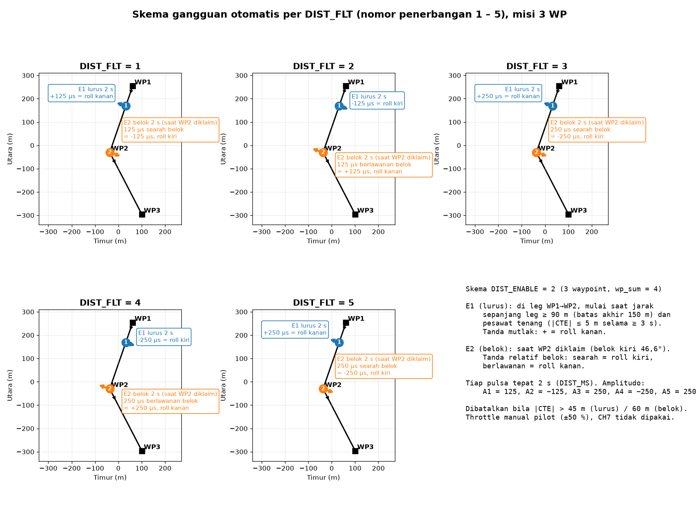

| DIST_FLT | Amplitudo | **E1: leg lurus WP1→WP2** (tanda mutlak, + = roll kanan) | **E2: belok di WP2** (tanda relatif terhadap arah belok) | E2 sebagai roll |
|---|---|---|---|---|
| 1 | A1 = 125 µs | +125 µs → roll kanan | 125 µs **searah** belok | kiri (−125) |
| 2 | A2 = −125 µs | −125 µs → roll kiri | 125 µs **berlawanan** belok | kanan (+125) |
| 3 | A3 = 250 µs | +250 µs → roll kanan | 250 µs **searah** belok | kiri (−250) |
| 4 | A4 = −250 µs | −250 µs → roll kiri | 250 µs **berlawanan** belok | kanan (+250) |
| 5 | A5 = 250 µs | +250 µs → roll kanan | 250 µs **searah** belok | kiri (−250) |

Aturan umum:
- **E1** mulai saat jarak sepanjang leg ≥ 90 m (batas akhir 150 m) dan pesawat "tenang": |CTE| ≤ 5 m terus-menerus ≥ 3 s.
- **E2** mulai tepat saat WP2 diklaim (belok kiri 46,6°; heading 199,1° → 152,5°), bila sebelum itu tenang.
- Tiap pulsa tepat **2 s** (`DIST_MS = 2000`), ditambahkan ke perintah aileron setelah kontroler attitude.
- Dibatalkan bila |CTE| > 45 m (lurus) atau 60 m (belok) selama pulsa aktif.
- Throttle manual dari pilot (±50 %). `DIST_US` tidak dipakai di mode 2; amplitudo ada di tabel kode.

Logika tiap event:

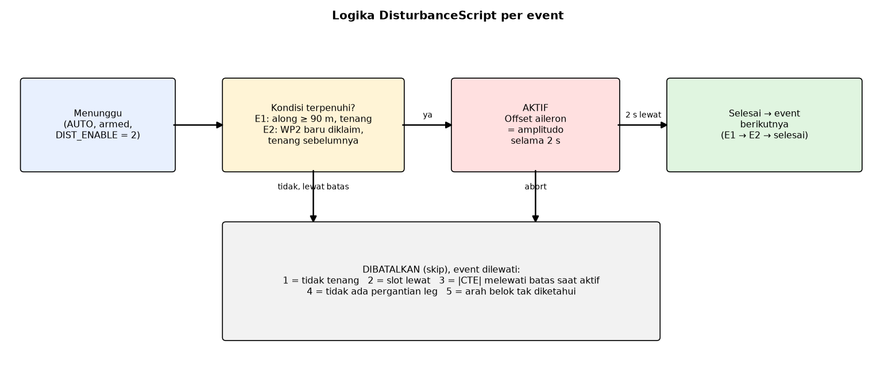

Karena belok WP2 adalah belok **kiri**, "searah belok" berarti roll ke kiri (menambah bank), dan "berlawanan belok" berarti roll ke kanan (mengurangi bank).

---

## 2. Identifikasi log dan kondisi uji

| Log | DIST_FLT | Keterangan |
|---|---|---|
| 12:58 | — (DIST_ENABLE 0) | Baseline tanpa gangguan |
| 13:15 | 1 | F1 |
| 13:46 | 3 | F3. Ada disarm sesaat di 112,9–113,9 s |
| 13:51 | 2 | **Tidak masuk AUTO** (tanpa misi); tidak dipakai |
| 13:55 | 2 | F2 |
| 14:00 | 4 | F4 |
| 14:06 | 5 | F5 |

Lima terbang valid: **13:15, 13:55, 13:46, 14:00, 14:06**.

Parameter sama di semua terbang: `DIST_ENABLE=2`, `DIST_MS=2000`, `FUZZY_ENABLE=0`, `NAVL1_PERIOD=15`, `NAVL1_DAMPING=0.707`, `ROLL_LIMIT_DEG=45`, `WP_RADIUS=15`, `AIRSPEED_CRUISE=18`.

Misi (koordinat relatif home, m): WP1 (61,4; 253,8), WP2 (−37,0; −30,2), WP3 (101,0; −296,5). Leg WP1→WP2 ±300,6 m, leg WP2→WP3 ±299,9 m.

Catatan metode: leg masuk AUTO (entry→WP1) dibuang dari seluruh analisis karena AUTO selalu dimulai jauh dari WP1 (CTE 103–126 m, melewati batas 45 m), jadi tidak layak dibandingkan.

---

## 3. Ringkasan hasil lima terbang

1. **Gangguan di belok WP2 terbukti masuk di kelima terbang.** Selisih roll aktual terhadap perintah L1: 16–22° untuk 125 µs dan 30–39° untuk 250 µs, tandanya sesuai arah gangguan.
2. **Gangguan di leg lurus tidak terlihat di kelima terbang** (selisih roll hanya 2–9°, CTE tidak bergeser sesuai tanda). Penyebabnya sudah ditemukan: E1 dibatalkan oleh skrip karena jarak basi di siklus pertama setelah WP1 diklaim, jadi E1 tidak pernah dikirim ke servo (bagian 6).
3. **Efek gangguan belok tidak simetris.** Searah belok (F1, F3, F5) mengurangi overshoot (2,3–4,0 m dibanding baseline 16,2 m). Berlawanan belok (F2, F4) menambah overshoot (17,9 dan 25,6 m).
4. **Gangguan 250 µs searah belok melewati batas roll 45°:** F3 −59,8°, F5 −49,3°.
5. **Kecepatan udara di leg belok berbeda antar-terbang** (14,3–21,3 m/s) dan memengaruhi overshoot.

Cakupan: dari 10 event yang direncanakan (5 terbang × 2), **5 event belok terbukti**, **0 event lurus terbukti**.

---

## 4. Analisis per terbang

Konvensi gambar per terbang (kiri: jalur; kanan atas: CTE; kanan bawah: roll):
bintang oranye/area oranye = E1 (lurus), bintang merah/area merah = E2 (belok). Area berwarna adalah jendela pulsa 2 s menurut putar-ulang kode skrip dengan data log. CTE positif = di kanan garis; pada belok kiri, sisi luar = CTE positif.

### F1 — DIST_FLT = 1 (log 13:15-54): lurus +125 µs, belok 125 µs searah (roll kiri)

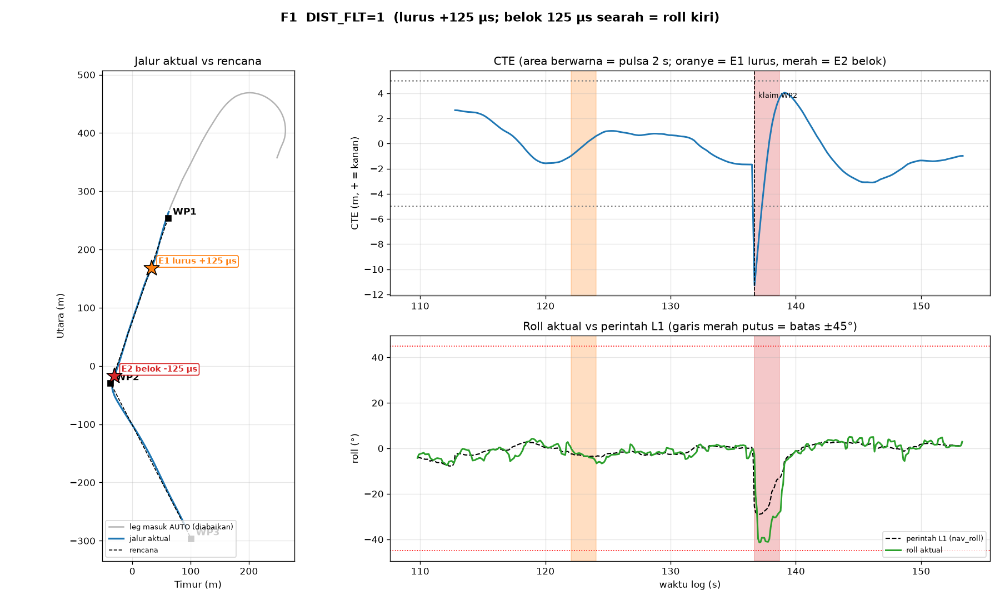

- AUTO 89,7–156,7 s. WP1 diklaim 112,8 s, WP2 136,7 s.
- **E1 (lurus, 122,0 s, along 90 m):** tidak terlihat. Selisih roll ekstrem −3,1° (tanda berlawanan dengan +125 µs), CTE maksimum di leg lurus 2,7 m (RMS 1,3 m). Tidak ada pergeseran.
- **E2 (belok, 136,7 s):** terbukti. Perintah L1 −28,9°, roll aktual mencapai **−41,4°** (selisih −15,8°). Pesawat membelok lebih cepat dari perintah.
- **Hasil belok:** overshoot luar 4,0 m (baseline 16,2 m), CTE sisi dalam −11,3 m (pada klaim, efek ganti garis), IAE 15 s = 36 m·s, keluar pita ±5 m terakhir pada 0,4 s.
- **Kesimpulan:** gangguan searah 125 µs menambah bank sehingga belok lebih cepat dan overshoot kecil. Ini perbaikan lintasan, bukan gangguan yang memperburuk.

### F2 — DIST_FLT = 2 (log 13:55-32): lurus −125 µs, belok 125 µs berlawanan (roll kanan)

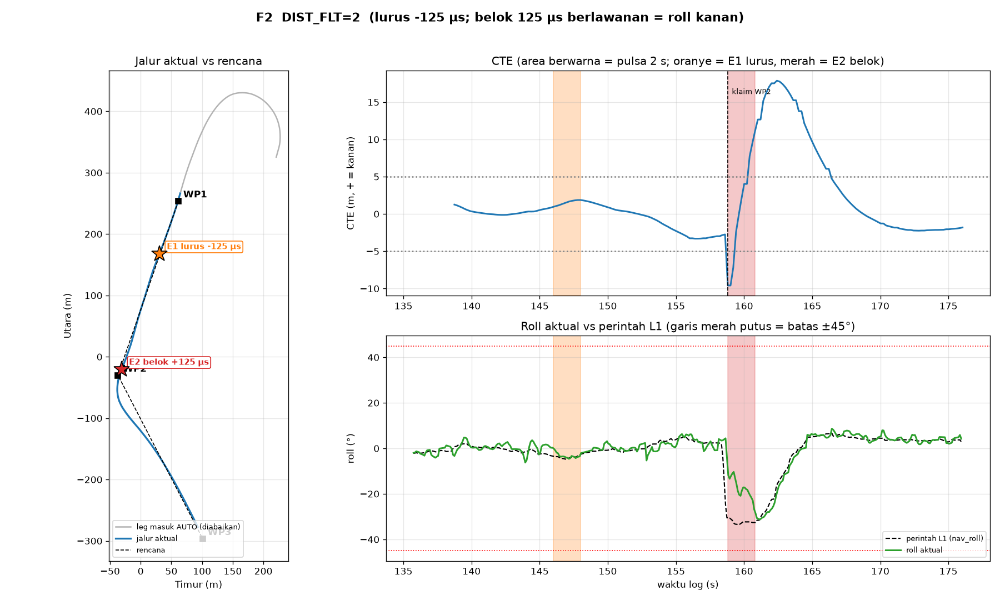

- AUTO 119,4–179,4 s. WP1 138,7 s, WP2 158,8 s.
- **E1 (lurus, 146,0 s):** tidak terlihat. Selisih roll +3,1°, CTE maksimum 3,3 m (RMS 1,6 m).
- **E2 (belok, 158,8 s):** terbukti. L1 memerintah −33°, tetapi selama pulsa roll aktual hanya sekitar −13° sampai −21°, tertinggal sampai **+22°** dari perintah. Setelah pulsa selesai roll mengejar perintah.
- **Hasil belok:** overshoot luar **17,9 m** (puncak 3,6 s setelah klaim), CTE sisi dalam −9,6 m, IAE 97 m·s, keluar pita ±5 m terakhir pada 7,4 s. Roll minimum hanya −31,3°.
- **Kesimpulan:** gangguan berlawanan 125 µs menahan pesawat keluar dari belokan. Dampaknya terhadap CTE hanya +1,7 m dari baseline (16,2 m), sehingga hampir tidak terbedakan dari variasi antar-terbang.

### F3 — DIST_FLT = 3 (log 13:46-25): lurus +250 µs, belok 250 µs searah (roll kiri)

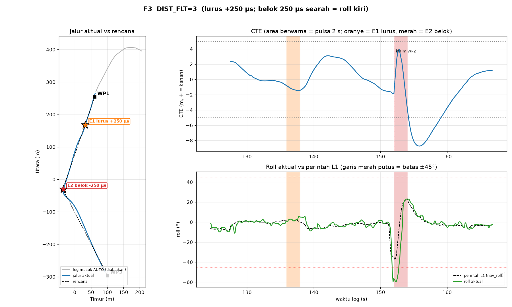

- AUTO efektif 113,9–170,1 s (didahului AUTO singkat 111,0–112,9 s yang terputus oleh disarm sesaat). WP1 127,5 s. **Klaim WP2 tidak tercatat di telemetri**, diperkirakan 152,0 s (jarak terdekat 2,3 m).
- **E1 (lurus, 135,9 s):** tidak terlihat. Selisih roll maksimum +8,9° (padahal 250 µs seharusnya ≈ 30°), CTE maksimum 3,1 m (RMS 1,6 m). Ada kenaikan CTE ke +3,1 m sekitar 4–5 s setelah pulsa, tetapi besarnya setara variasi alami di baseline.
- **E2 (belok, 152,0 s):** terbukti dan **sangat kuat**. L1 memerintah −37,6°, roll aktual mencapai **−59,8°** (selisih −37,6°), jauh di atas batas 45°. Setelah pulsa, roll berayun ke +23° mengikuti perintah L1 yang berbalik.
- **Hasil belok:** overshoot luar 3,9 m, tetapi CTE sisi dalam −8,7 m (pada ≈ 155,8 s). Pesawat memotong belokan terlalu dalam. IAE 54 m·s, keluar pita ±5 m terakhir 7,0 s.
- **Anomali:** disarm sesaat di 112,9–113,9 s (throttle servo 988 µs) sehingga leg masuk terputus. Kunci penyebab belum ada (bagian 7).
- **Kesimpulan:** 250 µs searah adalah gangguan paling agresif secara roll, dan melanggar batas 45°. Efeknya pada CTE kecil, tetapi bukan gangguan yang "menyulitkan" jalur.

### F4 — DIST_FLT = 4 (log 14:00-06): lurus −250 µs, belok 250 µs berlawanan (roll kanan)

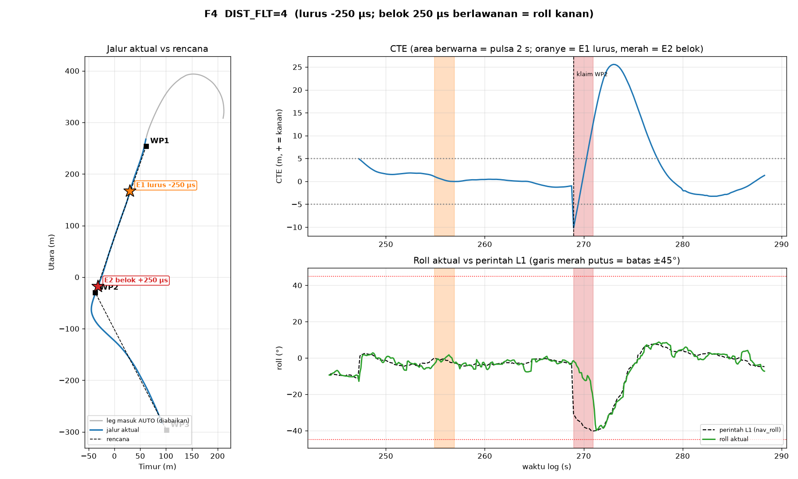

- AUTO 232,6–292,6 s. WP1 247,3 s, WP2 269,0 s.
- **E1 (lurus, 254,9 s):** tidak terlihat. Selisih roll +3,3°, CTE maksimum di leg lurus hanya 1,8 m (tidak termasuk nilai awal 4,9 m yang berasal dari masuknya leg).
- **E2 (belok, 269,0 s):** terbukti. L1 memerintah −31° sampai −40°, tetapi roll aktual hanya −5° sampai −13° selama pulsa, tertinggal hingga **+30°**. Pesawat nyaris tidak membelok selama 2 s, lalu mengejar setelah pulsa selesai.
- **Hasil belok:** overshoot luar **25,6 m** (terbesar di semua terbang, puncak 4,0 s setelah klaim), CTE sisi dalam −10,2 m, IAE **145 m·s**, keluar pita ±5 m terakhir **8,5 s**. Tidak mencapai batas abort 60 m.
- **Kesimpulan:** inilah gangguan yang benar-benar memperburuk lintasan: overshoot 9,4 m lebih besar dari baseline dan pemulihan paling lama. Kasus paling berguna untuk menguji fuzzy.

### F5 — DIST_FLT = 5 (log 14:06-38): lurus +250 µs, belok 250 µs searah (roll kiri)

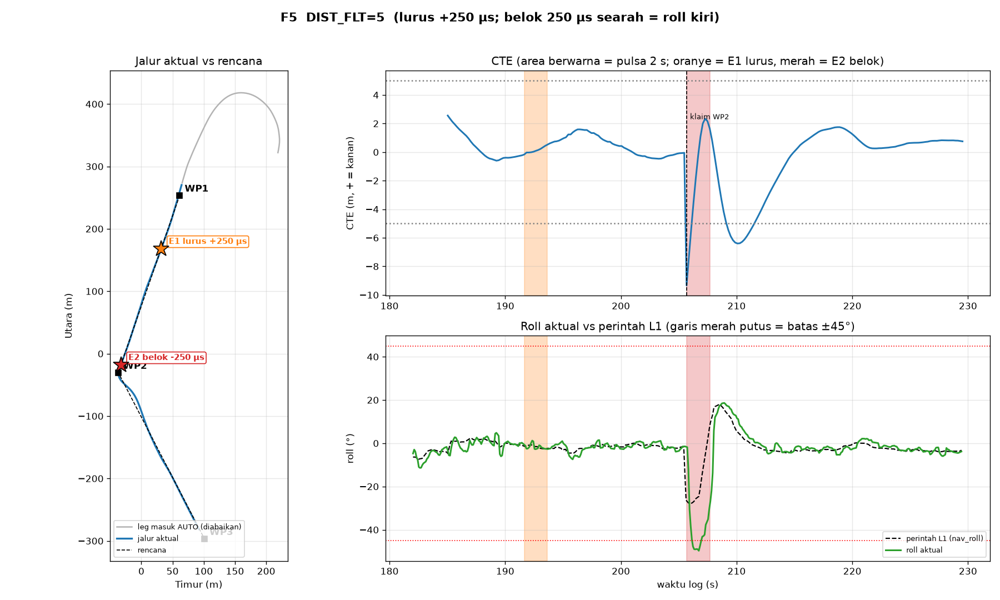

- AUTO 169,2–233,5 s. WP1 185,0 s, WP2 205,7 s.
- **E1 (lurus, 191,7 s):** tidak terlihat. Selisih roll +2,2°, CTE maksimum 2,6 m (RMS 0,9 m).
- **E2 (belok, 205,7 s):** terbukti. L1 memerintah −28°, roll aktual **−49,3°** (selisih −39,0°), melewati batas 45°. Setelah pulsa roll berbalik ke +18,6°.
- **Hasil belok:** overshoot luar **2,3 m** (terkecil), CTE sisi dalam −9,3 m, IAE 39 m·s, keluar pita ±5 m terakhir 5,8 s.
- **Faktor kecepatan:** IAS rata-rata di leg belok hanya **14,3 m/s** (GS 12,3 m/s), jauh di bawah `AIRSPEED_CRUISE` 18 m/s dan terendah di antara terbang. Sebagian overshoot kecil berasal dari kecepatan rendah, bukan dari gangguan.
- **Risiko:** bank −49° pada 14 m/s mempersempit margin stall.

---

## 5. Perbandingan gabungan

### 5.1 Belok WP2→WP3 (belok kiri)

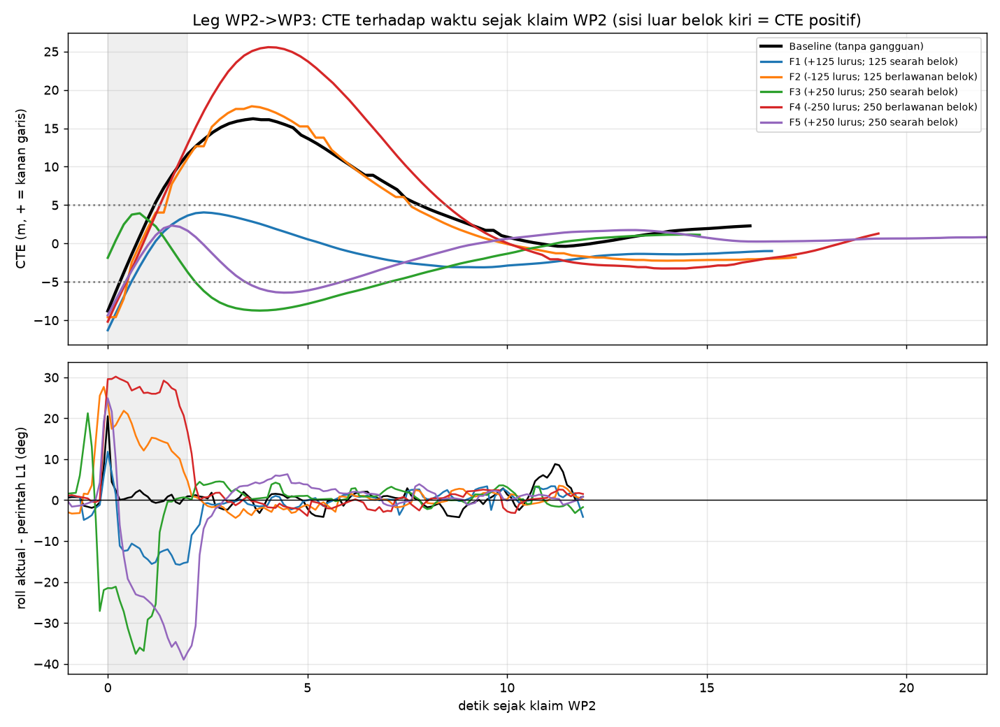

| Terbang | Gangguan di belok | Overshoot luar (m) | CTE sisi dalam (m) | IAE 15 s (m·s) | RMS 25 s (m) | Keluar pita ±5 m terakhir (s) | Roll min (°) | Selisih roll vs L1 (°) | IAS (m/s) |
|---|---|---|---|---|---|---|---|---|---|
| Baseline | tidak ada | 16,2 | −8,8 | 93 | 8,1 | 7,7 | −39,0 | +4,4 | 21,3 |
| F1 | 125 searah | 4,0 | −11,3 | 36 | 2,9 | 0,4 | −41,4 | −15,8 | 20,3 |
| F2 | 125 berlawanan | 17,9 | −9,6 | 97 | 8,2 | 7,4 | −31,3 | +21,8 | 18,7 |
| F3 | 250 searah | 3,9 | −8,7 | 54 | 4,6 | 7,0 | **−59,8** | −37,6 | 20,8 |
| F4 | 250 berlawanan | **25,6** | −10,2 | **145** | 11,3 | 8,5 | −39,9 | +30,2 | 19,4 |
| F5 | 250 searah | 2,3 | −9,3 | 39 | 2,7 | 5,8 | **−49,3** | −39,0 | **14,3** |

Roll aktual vs perintah L1 di belok, semua terbang:

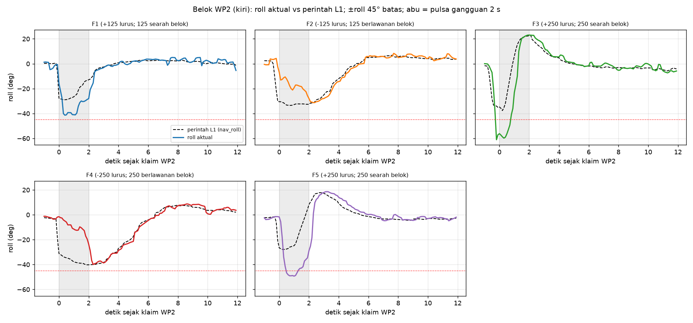

Jalur di sekitar WP2:

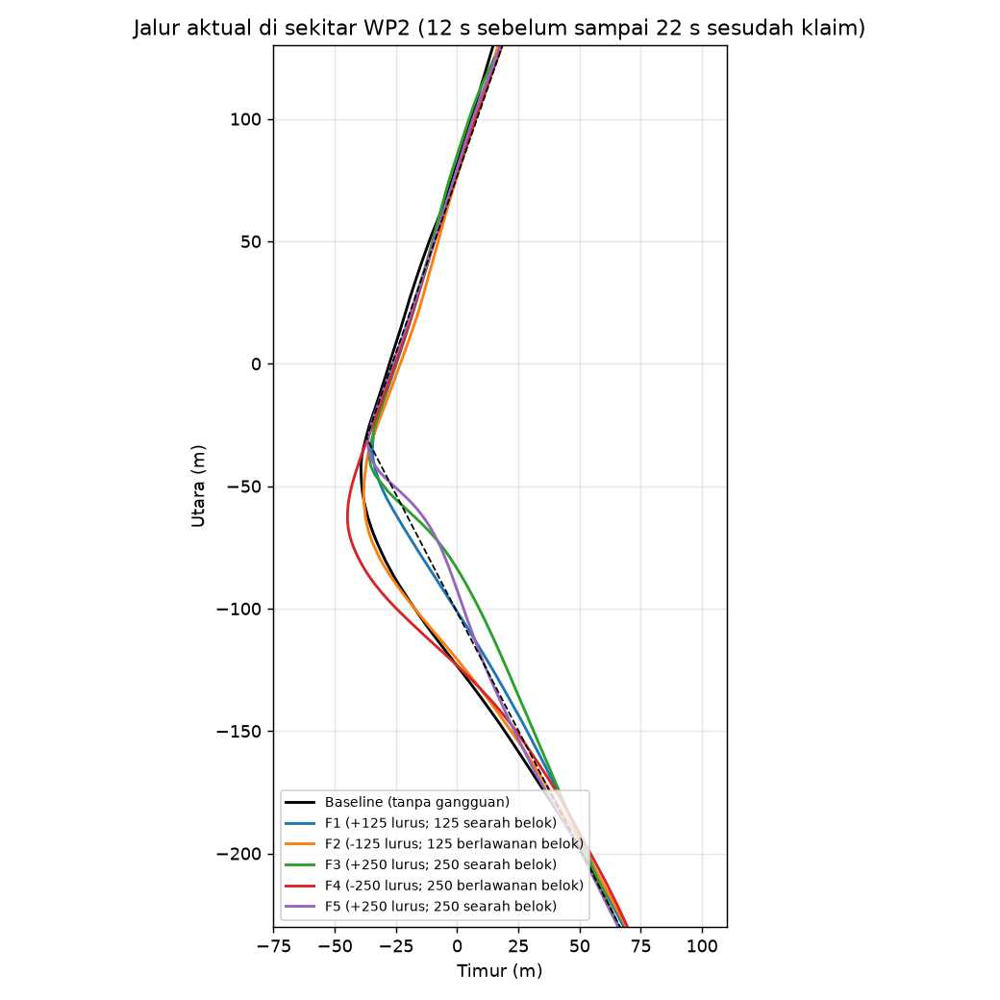

Besar gangguan terhadap respons roll (selisih roll aktual − perintah L1, ekstrem dalam 6 s sejak klaim):

| Amplitudo | Selisih roll terukur | Kira-kira per µs |
|---|---|---|
| 125 µs | 16° (searah), 22° (berlawanan) | 0,13–0,17 °/µs |
| 250 µs | 30° (berlawanan), 38–39° (searah) | 0,12–0,16 °/µs |

Respons kira-kira linear terhadap amplitudo. Angka ini lebih besar dari perkiraan awal (125 µs ≈ 12°) karena diambil ekstrem dalam jendela 6 s, bukan rata-rata.

### 5.2 Leg lurus WP1→WP2

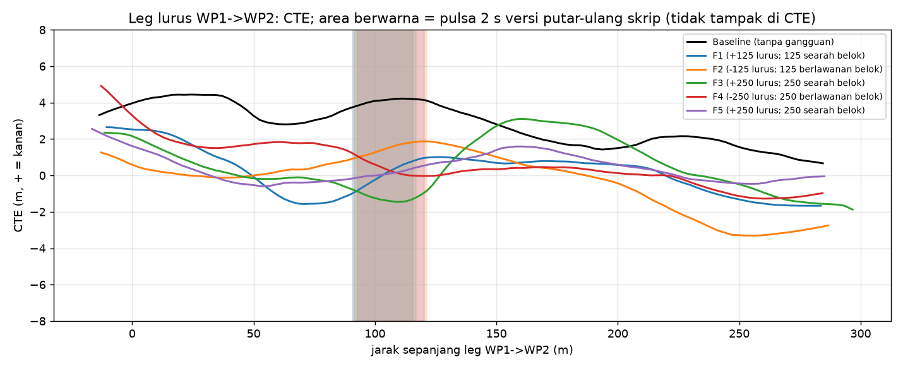

| Terbang | CTE maks (m) | CTE RMS (m) | IAS (m/s) | GS (m/s) |
|---|---|---|---|---|
| Baseline | 4,4 | 2,9 | 19,4 | 14,7 |
| F1 | 1,7 | 1,0 | 17,6 | 12,5 |
| F2 | 3,3 | 1,7 | 18,4 | 14,9 |
| F3 | 3,1 | 1,5 | 14,5 | 12,5 |
| F4 | 1,8 | 1,0 | 17,0 | 13,8 |
| F5 | 1,6 | 0,7 | 16,6 | 14,2 |

Statistik dihitung tanpa 3 s awal leg. CTE di leg lurus kecil di semua terbang termasuk baseline.

### 5.3 Pengaruh arah gangguan

| Kelompok | Terbang | Overshoot luar | Interpretasi |
|---|---|---|---|
| Searah belok (menambah bank) | F1, F3, F5 | 2,3 – 4,0 m | belok lebih cepat; overshoot turun; roll bisa melewati 45° (F3, F5) |
| Berlawanan belok (mengurangi bank) | F2, F4 | 17,9 dan 25,6 m | belok tertahan; overshoot naik; efek besar hanya di 250 µs |
| Tanpa gangguan | baseline | 16,2 m | acuan |

---

## 6. Kenapa gangguan lurus (E1) tidak muncul: penyebab ditemukan

**Kesimpulan:** E1 tidak pernah sampai ke servo di kelima terbang. Bukan karena pesawat tidak merespons, melainkan karena skrip membatalkan E1 (skip alasan 1) sesaat setelah WP1 diklaim, akibat nilai jarak yang basi (stale) pada satu siklus.

### 6.1 Bukti dari telemetri servo

`SERVO_OUTPUT_RAW.servo1_raw` dibaca dari `aileron_left_.readMicroseconds()`, yaitu nilai yang benar-benar ditulis ke servo, **termasuk offset gangguan**. (Dugaan saya sebelumnya bahwa telemetri servo tidak memuat offset salah.)

Di luar pulsa, servo mengikuti kontroler dengan sangat rapat: `servo1 ≈ 1500 + 10·(roll − nav_roll)`, R² 0,90–0,96, simpangan sisa hanya 4–6 µs. Selisih (residual) servo terhadap rumus itu adalah offset gangguan yang sebenarnya:

| Terbang | Event | Residual servo selama 2 s | Kesimpulan |
|---|---|---|---|
| F1 | E1 +125 µs @122,0 s | 0 µs | tidak terkirim |
| F1 | E2 125 µs searah @136,7 s | +110 µs (puncak +142) | terkirim |
| F2 | E1 −125 µs @146,0 s | 0 µs | tidak terkirim |
| F2 | E2 125 µs berlawanan @158,8 s | −100 µs (puncak −137) | terkirim |
| F3 | E1 +250 µs @135,9 s | −2 µs | tidak terkirim |
| F3 | E2 250 µs searah @152,0 s | +177 sampai +270 µs | terkirim |
| F4 | E1 −250 µs @254,9 s | 0 µs | tidak terkirim |
| F4 | E2 250 µs berlawanan @269,0 s | −218 µs (puncak −269) | terkirim |
| F5 | E1 +250 µs @191,7 s | +1 µs | tidak terkirim |
| F5 | E2 250 µs searah @205,7 s | +253 µs (puncak +305) | terkirim |

(Tanda residual servo terbalik terhadap tanda gangguan karena aileron kiri dipasang terbalik; besarnya sesuai amplitudo.)

Menyapu seluruh AUTO tiap terbang: satu-satunya segmen dengan |residual| > 50 µs adalah pulsa E2, panjangnya ±2 s. Tidak ada pulsa lain di mana pun.

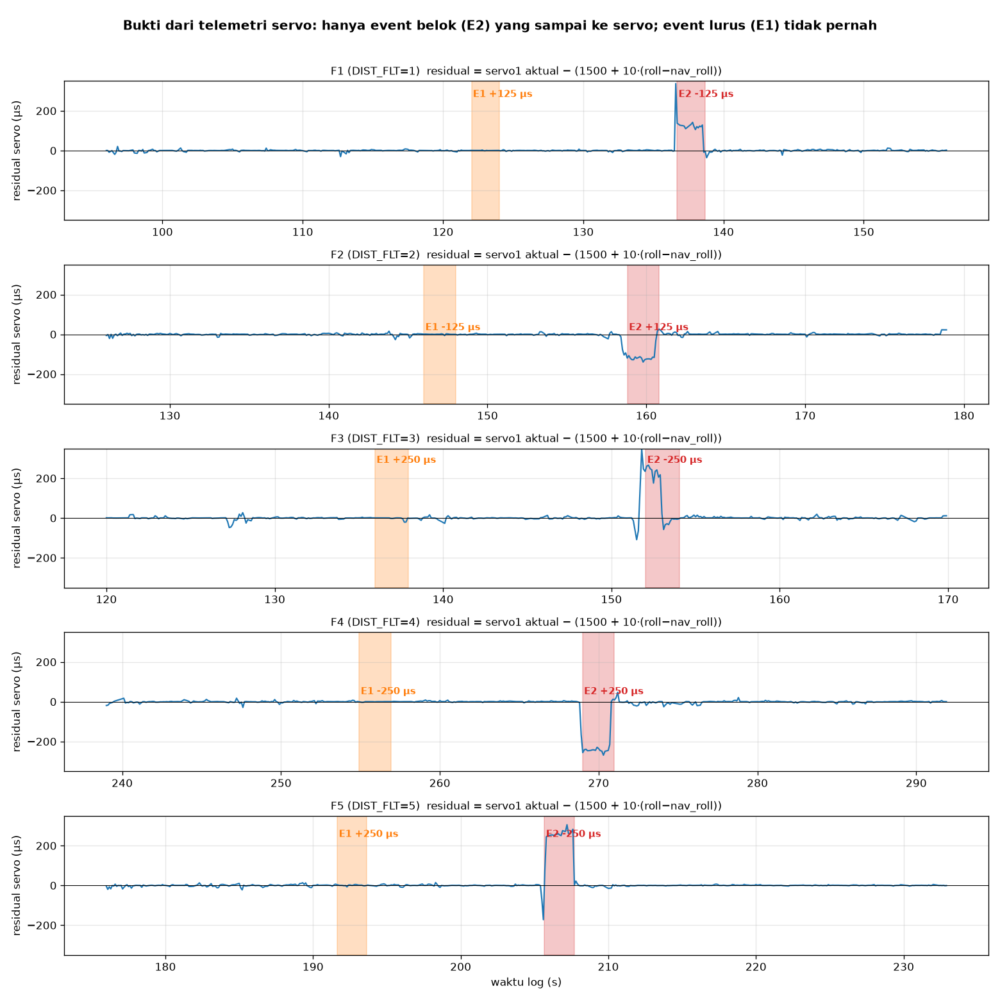

Jadi gangguan di leg lurus tidak "kecil", tetapi memang tidak pernah diberikan.

### 6.2 Penyebab di kode

Urutan dalam `ModeAuto::_update` (`src/modes/FixedWingModes.cpp`):
1. `navigation.navigate(...)` dipanggil lebih dulu. Di dalamnya `distance_next_wp` dihitung di awal (`Navigation.cpp:472`), lalu bila WP diklaim, `flag_wp++` dan `setNextWaypoint(...)` mengganti `prev_wp_loc` dan `next_wp_loc` ke leg berikutnya. **`distance_next_wp` tidak dihitung ulang** di siklus yang sama.
2. Setelah itu `script_in.along_m` dihitung sebagai `panjang leg − distance_next_wp` (`FixedWingModes.cpp:119-122`).

Pada siklus pertama setelah WP1 diklaim: `flag_wp` sudah 2 dan leg sudah WP1→WP2 (±300,6 m), tetapi `distance_next_wp` masih jarak lama ke WP1 (±11–21 m, tepat radius klaim). Hasilnya `along_m ≈ 300 − 15 ≈ 285 m`.

Di `DisturbanceScript::update` (`src/control/DisturbanceScript.cpp:134-135`), event lurus langsung dibatalkan bila `flag_wp == e.flag` dan `along_m > end_m` (150 m): `skip(1)` ("tidak tenang"). Satu siklus 50 Hz sudah cukup. E1 berstatus dilewati, indeks maju ke E2, lalu E2 menembak normal saat WP2 diklaim (karena sebelumnya `idx_` sudah maju). Itu tepat yang terlihat di data: E2 berhasil, E1 tidak pernah.

Reproduksi dengan kelas asli `DisturbanceScript` (tanpa mengubah kode):

| Skenario | Hasil |
|---|---|
| `along` ideal (naik mulus 0 → 300 m) | E1 menembak di 90 m, E2 menembak; fire = 2, skip = 0 |
| Dengan satu sampel basi (`along` = 285 m) di awal leg | E1 di-skip alasan 1, E2 menembak; fire = 1, skip = 1 |

Uji unit di `test/host/test_disturbance_script.cpp` memberi `along` ideal, sehingga bug ini tidak pernah tertangkap.

Konfirmasi tambahan yang masih bisa diambil: di CSV SD (LOG029–LOG034) seharusnya ada baris `#EVENT,...,DIST_SKIP,E1,reason=1` tepat pada waktu klaim WP1 di tiap terbang, dan tidak ada `DIST_ON,...,E1`.

### 6.3 Dampak dan perbaikan yang diusulkan (belum dilakukan)

Dampak:
- Skenario 3 WP: E1 selalu hilang; hanya E2 yang bekerja (sesuai data kelima terbang).
- Skenario 6 WP (`wp_sum = 7`): semua event lurus (L1 di leg WP1→WP2 dan L5 di leg WP5→WP6) kena masalah yang sama.
- Event belok tidak terpengaruh.

Perbaikan paling kecil (belum diterapkan; menunggu persetujuan Anda karena ini mengubah firmware):
- Hitung `along_m` dari posisi saat ini, bukan dari `distance_next_wp` yang bisa basi: `prev_wp_loc.get_distance(current_loc)` (jarak dari awal leg ke pesawat), atau hitung ulang `distance_next_wp` setelah `setNextWaypoint`.
- Tambahkan kasus uji dengan satu sampel basi di awal leg di `test_disturbance_script.cpp`.

Setelah itu, uji terbang 5 kali dengan DIST_FLT 1 – 5 perlu diulang agar E1 ikut terbukti.

## 7. Anomali dan risiko keselamatan

- **F3 (13:46):** status armed hilang sekitar 1 detik di AUTO (112,9–113,9 s), throttle servo turun ke 988 µs. Penyebab belum diketahui. Leg masuk terputus; CTE masuk 46,7 m.
- **Roll > 45°:** F3 −59,8° dan F5 −49,3° pada gangguan 250 µs searah belok. `ROLL_LIMIT_DEG=45` membatasi perintah L1 saja; gangguan ditambahkan setelah kontroler sehingga batas tidak berlaku pada total. Disarankan **tidak menaikkan ke 300 µs**. Pertimbangkan membatasi A3/A5 searah belok atau membalik arahnya, dengan persetujuan pembimbing (nilai 125/250 µs berasal dari Tabel 3.7 proposal).
- **F5:** IAS 14,3 m/s dengan bank −49°; margin stall kecil.
- **Waktu klaim WP2 F3** diperkirakan 152,0 s karena tidak ada di telemetri; timing belok F3 punya ketidakpastian beberapa persepuluh detik.

---

## 8. Catatan untuk perbandingan dengan L1 + fuzzy

1. **Baseline hanya satu kali.** Variasi antar-terbang yang normal tidak diketahui. Selisih F2 dengan baseline (1,7 m) berada dalam variasi tersebut.
2. **Kecepatan udara berbeda antar-terbang** (belok: 14,3 / 18,7 / 19,4 / 20,3 / 20,8 / 21,3 m/s). Dengan T tetap, jarak L1 = T·V/π bergantung kecepatan, dan radius belok bergantung V². Catat IAS dan GS di tabel hasil, dan bila bisa bandingkan terbang berkecepatan sebanding.
3. **Bandingkan per nomor terbang yang sama** (F1 dengan F1 fuzzy, dst.), karena efek gangguan bergantung pada tanda.
4. **Gangguan searah belok bisa membantu.** Bila overshoot fuzzy turun pada F1/F3/F5, bagian dari penurunan itu bisa berasal dari gangguan, bukan dari fuzzy. **F2 dan F4 (berlawanan belok)** paling informatif karena di situ gangguan memperburuk lintasan (17,9 dan 25,6 m).
5. Karena E1 tidak pernah dikirim (bug jarak basi, bagian 6), perbandingan dengan fuzzy pada data ini hanya valid untuk **gangguan di belok WP2**. Bila bug diperbaiki dan terbang diulang, data gangguan lurus bisa dilengkapi, tetapi baseline dan fuzzy harus memakai skenario yang sama.
6. Pemulihan sebaiknya diukur dengan "keluar pita ±5 m terakhir", bukan `pemulihan_s` bawaan analyzer (yang mencatat waktu pertama masuk pita dan bisa 0 s walau CTE kembali melewati 5 m, contoh F3).

---

## 9. Definisi metrik dan daftar berkas

Definisi:
- **CTE:** dihitung ulang dari `GLOBAL_POSITION_INT` terhadap garis prev→next WP (+ = kanan garis).
- **Overshoot luar:** CTE positif maksimum setelah klaim WP2 (belok kiri, sisi luar = kanan).
- **IAE 15 s:** integral |CTE| dari klaim WP2 sampai 15 s.
- **Keluar pita ±5 m terakhir:** waktu terakhir |CTE| > 5 m dalam 25 s sejak klaim.
- **Selisih roll vs L1:** `ATTITUDE.roll` − `NAV_CONTROLLER_OUTPUT.nav_roll`, ekstrem dalam 6 s sejak klaim (belok) atau 3 s sejak awal pulsa (lurus).
- **Waktu:** t0 = pesan ATTITUDE pertama dalam log.

Berkas di folder ini:
- `30_skema_dist_flt.png`, `31_logika_skrip.png`: skema DIST_FLT dan logika skrip.
- `41_F1_ringkasan.png` … `45_F5_ringkasan.png`: ringkasan per terbang.
- `50_bukti_servo_E1_tidak_terkirim.png`: residual servo terhadap kontroler, bukti E1 tidak terkirim.
- `20_cte_belok_semua.png`, `21_roll_vs_perintah_belok_semua.png`, `22_cte_lurus_semua.png`, `23_jalur_sekitar_WP2.png`: perbandingan semua terbang.
- `ringkasan_perbandingan.csv` / `.json`: angka tabel bagian 5.
- `F1_13-15-54` … `F5_14-06-38`: gambar standar analyzer, `metrik_per_leg.csv`, `cte_per_sampel.csv`, `run.txt`, `param_dan_misi.txt`.
- Folder `../flight_2026-11-15_baseline` (12:58) dan `../flight_2026-11-15_gangguan` (13:15) sudah ada sebelumnya.
