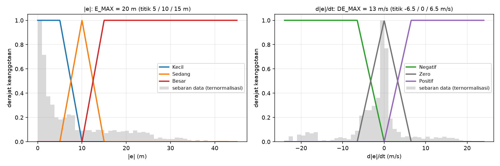
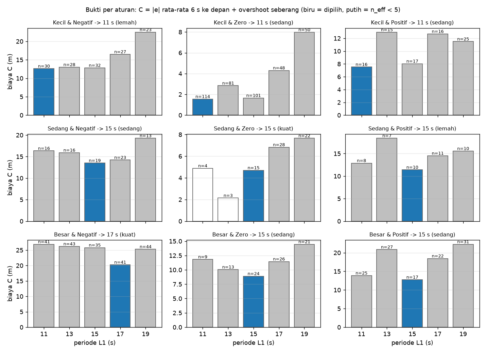
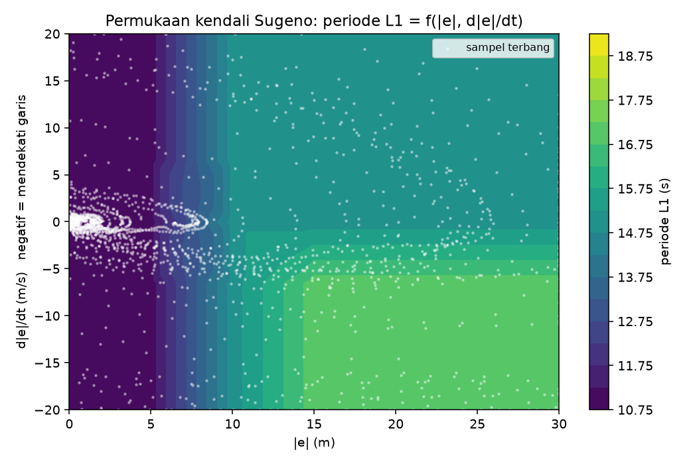
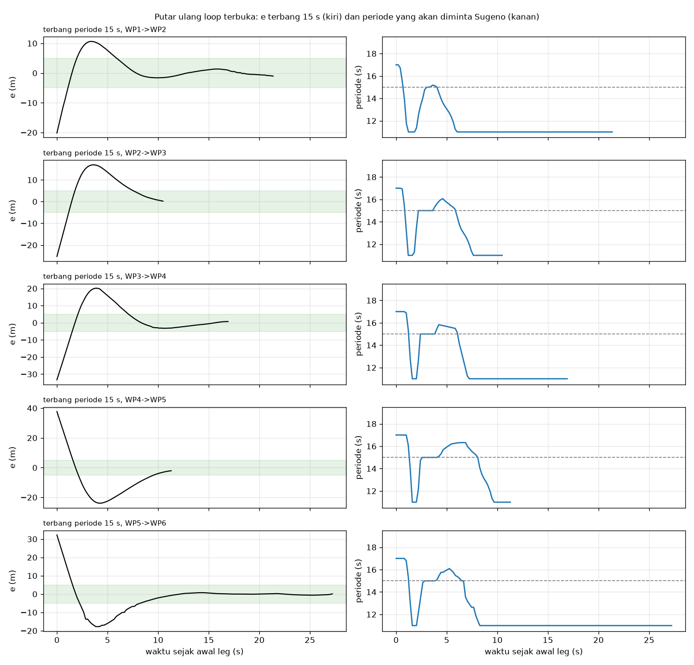

# Desain fuzzy Sugeno orde-0 untuk periode L1 (data uji 30/10/2026)

Dokumen ini menjelaskan **lengkap** bagaimana fuzzy Sugeno orde-0 untuk
menyetel periode L1 disusun dari lima terbang L1 konvensional tanggal 30/10/2026
(periode 11, 13, 15, 17, 19 s): istilah yang dipakai, dasar setiap keputusan,
dan urutan fuzzy dari fuzzifikasi sampai defuzzifikasi.

- Perhitungan: `tools/flight_analysis/design_fuzzy_sugeno.py`.
- Versi manual Excel dengan metode yang sama: `../excel_fuzzy_sugeno_2026-10-30/`.
- **Hanya desain offline. Belum dimasukkan ke firmware.**

## Daftar isi

0. Hasil akhir dalam satu halaman
1. Daftar istilah dan simbol
2. Gambaran sistem: apa yang diatur fuzzy dan kenapa
3. Data: dari tlog ke |e| dan d|e|/dt
4. Dasar setiap keputusan desain
5. Urutan fuzzy langkah demi langkah
   - Langkah 0: semesta dan normalisasi
   - Langkah 1: fuzzifikasi
   - Langkah 2: rule base
   - Langkah 3: inferensi
   - Langkah 4: defuzzifikasi
6. Satu contoh ditelusuri dari awal sampai akhir (+ dua contoh singkat)
7. Putar ulang loop terbuka
8. Perbandingan dengan versi Excel
9. Keputusan terbuka dan keterbatasan
10. Langkah berikutnya dan cara membuat ulang
11. Dasar pita pulih 5 m dan waktu tahan 2 s

---

## 0. Hasil akhir dalam satu halaman

| Komponen | Nilai |
|---|---|
| Masukan 1 | \|e\| (m), dinormalisasi menjadi e_fn = min(1, \|e\| / **E_MAX**), **E_MAX = 20 m** |
| Masukan 2 | d\|e\|/dt (m/s, negatif = mendekati garis), dinormalisasi menjadi de_fn = clip(d\|e\|/dt / **DE_MAX**, −1, 1), **DE_MAX = 13 m/s** |
| Himpunan e_fn | Kecil, Sedang, Besar (titik 0,25 / 0,5 / 0,75 = **5 / 10 / 15 m**) |
| Himpunan de_fn | Negatif, Zero, Positif (titik −0,5 / 0 / 0,5 = **−6,5 / 0 / 6,5 m/s**) |
| Jumlah aturan | 3 × 3 = 9 |
| Operator DAN | min |
| Konsekuen | konstanta ternormalisasi c ∈ {−1; −0,5; 0; +0,5; +1} |
| Defuzzifikasi | z* = Σ α·c / Σ α (rata-rata berbobot) |
| Keluaran | **periode L1 = P0 + S·z\* = 15 + 4·z\*** detik |

Rule base (isi sel = periode; c dalam kurung):

| \|e\| \ d\|e\|/dt | Negatif (mendekat) | Zero (tetap) | Positif (menjauh) |
|---|---|---|---|
| **Kecil** | 11 s (−1) | 11 s (−1) | 11 s (−1) |
| **Sedang** | 15 s (0) | 15 s (0) | 15 s (0) |
| **Besar** | **17 s (+0,5)** | 15 s (0) | 15 s (0) |

Dalam satu kalimat: **dekat garis → periode pendek 11 s untuk mengunci
lintasan; error sedang → periode dasar 15 s; error besar yang sedang cepat
kembali ke garis → periode panjang 17 s untuk menekan overshoot.**

---

## 1. Daftar istilah dan simbol

### 1a. Istilah navigasi dan L1

| Istilah | Arti |
|---|---|
| **L1 (pengendali L1)** | Algoritma navigasi lateral (dari ArduPilot) yang membuat pesawat mengejar sebuah titik di depannya pada garis lintasan, lalu menghasilkan perintah sudut roll. |
| **Periode L1** (`NAVL1_PERIOD`, s) | Parameter utama L1. Periode kecil = titik kejar dekat = belok tajam/agresif. Periode besar = titik kejar jauh = belok lunak. **Inilah keluaran fuzzy.** |
| **L1 distance** (m) | Jarak titik kejar di depan pesawat: L1 = (1/π) × damping × periode × groundspeed. Pada uji ini sekitar 44 m (11 s) sampai 74 m (19 s). |
| **Damping** (`NAVL1_DAMPING`) | Redaman L1, pada uji ini 0,707 (sama untuk semua periode). |
| **WP (waypoint)** | Titik tujuan misi. Misi uji punya 6 WP dengan leg 350 m dan 200 m bergantian. |
| **WP aktif** | WP yang sedang dituju. |
| **Leg** | Ruas garis lurus dari WP sebelumnya ke WP aktif, misalnya WP2→WP3. |
| **WP_TURN_ANT** | Antisipasi belokan: WP dianggap tercapai 25–40 m sebelum titiknya, supaya pesawat mulai belok lebih awal. Akibatnya di awal leg baru pesawat sudah berjarak ±25–40 m dari garis baru. |
| **Cross-track error, e** (m) | Jarak tegak lurus pesawat ke garis leg. Positif = pesawat di kanan garis, negatif = di kiri. |
| **Groundspeed** (m/s) | Kecepatan pesawat terhadap tanah dari GPS. |
| **Course / COG** (derajat) | Arah gerak pesawat terhadap tanah dari GPS, 0 = utara. |
| **nav_roll** (derajat) | Sudut roll yang diminta L1 ke pengendali attitude. Gerakannya mencerminkan "usaha kendali". |
| **Overshoot** (m) | Simpangan maksimum di **sisi seberang** garis setelah pesawat memotongnya. |
| **Zero-crossing** | Berapa kali pesawat memotong garis (e berganti tanda); ukuran osilasi. |
| **Pita pulih** | \|e\| ≤ 5 m. Pesawat dianggap sudah kembali ke lintasan bila tetap dalam pita ini selama 2 s. |
| **Fase transisi** | Dari awal leg sampai pesawat pulih (belum stabil di garis). |
| **Fase tunak** | Sesudah pulih (stabil di garis). |
| **tlog** | Rekaman telemetri MAVLink dari Mission Planner. |
| **Sampel** | Satu baris data posisi GPS; 5 per detik (5 Hz, tiap 0,2 s). |

### 1b. Variabel masukan dan keluaran fuzzy

| Simbol | Nama | Satuan | Arti |
|---|---|---|---|
| **e** | cross-track error | m | jarak bertanda ke garis (lihat 1a) |
| **\|e\|** atau **e_f** | error absolut | m | jarak ke garis tanpa memandang sisi; "seberapa jauh". Masukan fuzzy 1 |
| **e_rate** = de/dt | laju error bertanda | m/s | kecepatan pesawat menyamping terhadap garis (ke kanan positif) |
| **d\|e\|/dt** atau **de_f** | laju error absolut | m/s | seberapa cepat jarak ke garis berubah. **Negatif = mendekati garis, positif = menjauhi.** Masukan fuzzy 2 |
| **e_fn** | error ternormalisasi | – | \|e\| dibagi E_MAX, dibatasi 0…1 |
| **de_fn** | laju ternormalisasi | – | d\|e\|/dt dibagi DE_MAX, dibatasi −1…1 |
| **z\*** | keluaran ternormalisasi | – | hasil defuzzifikasi, −1…1 |
| **periode** | keluaran fuzzy | s | periode L1 yang diminta: 15 + 4·z* |

### 1c. Parameter desain

| Simbol | Nilai | Arti | Dari mana |
|---|---|---|---|
| **E_MAX** | 20 m | Batas atas \|e\| untuk normalisasi. \|e\| ≥ 20 m dianggap "maksimum" (e_fn = 1). | dua jangkar data (bagian 5, langkah 0) |
| **DE_MAX** | 13 m/s | Batas atas \|d\|e\|/dt\| untuk normalisasi. Laju di luar ±13 m/s dianggap ±1. | dua jangkar data |
| **P0** | 15 s | Periode dasar: periode yang dipakai bila z* = 0 ("tetap"). | data: kompromi terbaik uji konvensional |
| **S** | 4 s | Faktor skala: perubahan periode bila z* = ±1. | pilihan desain: P0 ± S = 11…19 s, rentang yang diterbangkan |
| **c** | −1 … +1 | Konstanta konsekuen tiap aturan (Sugeno orde-0). | dipilih dari data (bagian 5, langkah 2) |
| **H** | 6 s | Horizon: berapa detik ke depan hasil sebuah sampel dinilai. | pilihan desain ≈ waktu pulih rata-rata |
| **MIN_NEFF** | 5 | Jumlah sampel efektif minimum agar sebuah periode boleh dipilih untuk sebuah aturan. | pilihan desain |
| **BAND** | 5 m | Pita pulih (lihat 1a), dengan waktu tahan 2 s. | ketelitian GNSS, kecepatan memotong garis, dan uji sensitivitas (bagian 11) |

### 1d. Istilah fuzzy

| Istilah | Arti |
|---|---|
| **Logika fuzzy** | Logika yang memberi derajat kebenaran 0…1, bukan hanya benar/salah. |
| **Himpunan fuzzy** | Kategori yang batasnya tidak tegas, mis. "Kecil". Setiap angka masuk dengan derajat tertentu. |
| **Variabel linguistik** | Besaran yang nilainya kata, mis. \|e\| ∈ {Kecil, Sedang, Besar}. |
| **Fungsi keanggotaan, μ** | Rumus yang memberi derajat keanggotaan; μ_Kecil(e_fn) = 0,8 artinya "80 % tergolong Kecil". |
| **Semesta (universe)** | Rentang nilai yang diolah fuzzy: e_fn 0…1, de_fn −1…1. |
| **Normalisasi** | Membagi besaran fisik dengan batas atasnya supaya himpunan dibuat sekali di rentang baku. |
| **Saturasi / clip** | Memotong nilai di luar semesta ke batasnya (mis. e_fn > 1 menjadi 1). |
| **Segitiga / trapesium** | Bentuk fungsi keanggotaan: naik lurus, (datar,) turun lurus. |
| **Saling menyambung** | Himpunan bertetangga tumpang tindih sehingga jumlah μ di setiap titik = 1. |
| **Fuzzifikasi** | Langkah 1: mengubah angka menjadi derajat keanggotaan. |
| **Aturan (rule)** | Pernyataan JIKA … DAN … MAKA …. |
| **Anteseden** | Bagian JIKA sebuah aturan (kondisi). |
| **Konsekuen** | Bagian MAKA sebuah aturan (akibat). Pada Sugeno orde-0 berupa konstanta c. |
| **Rule base** | Kumpulan semua aturan (di sini 9). |
| **Firing strength, α** | Seberapa aktif sebuah aturan untuk masukan saat ini (0…1). |
| **Operator min** | Cara menghitung DAN: ambil derajat terkecil dari kedua kondisi. |
| **Inferensi** | Langkah 3: menghitung α semua aturan. |
| **Defuzzifikasi** | Langkah 4: menggabungkan hasil aturan menjadi satu angka. |
| **Rata-rata berbobot (weighted average)** | Σ α·c / Σ α: rata-rata konstanta aturan, dibobot kekuatannya. |
| **Sugeno orde-0** | Metode fuzzy yang konsekuennya konstanta dan keluarannya rata-rata berbobot. |
| **Mamdani** | Metode fuzzy lain yang konsekuennya himpunan fuzzy (tidak dipakai di sini). |

### 1e. Istilah statistik dan evaluasi

| Istilah | Arti |
|---|---|
| **Median (p50)** | Nilai tengah: separuh data di bawahnya. |
| **Persentil p10 / p95** | 10 % / 95 % data berada di bawah nilai ini. |
| **RMS** | Akar rata-rata kuadrat e; menghukum error besar lebih berat. |
| **J** (m) | \|e\| rata-rata pada H = 6 s **sesudah** sebuah sampel. Mengukur seberapa cepat pesawat mendekati garis. |
| **O** (m) | Overshoot: \|e\| terbesar di sisi seberang garis dalam 6 s sesudah sampel (0 bila tidak menyeberang). |
| **C** (m) | Biaya sebuah periode di sebuah aturan: C = J + O, rata-rata berbobot α. Kecil = lebih baik. |
| **n_eff** | Jumlah sampel efektif = Σ α. Sampel yang masuk setengah ke sebuah aturan dihitung 0,5. |
| **Margin** | Selisih relatif C periode terbaik dengan peringkat kedua; dasar label keyakinan. |
| **Keyakinan** | Kuat (margin ≥ 15 % dan n_eff ≥ 15), sedang (≥ 5 % dan ≥ 10), lemah (selain itu). |
| **Putar ulang loop terbuka** | Menjalankan fuzzy pada data terbang lama tanpa memengaruhi lintasan. Untuk memeriksa perilaku aturan saja. |
| **Loop tertutup** | Keluaran fuzzy benar-benar dipakai L1 sehingga lintasan ikut berubah (uji terbang / simulasi). |
| **Sensitivitas horizon** | Memeriksa apakah pilihan aturan berubah bila H diganti 4 s atau 8 s. |

---

## 2. Gambaran sistem: apa yang diatur fuzzy dan kenapa

```
   GPS ─► hitung |e| dan d|e|/dt ─► [ FUZZY SUGENO ] ─► periode L1 ─► [ L1 ] ─► nav_roll ─► pesawat
                                                                         ▲
                                                garis WP ────────────────┘
```

- L1 tetap yang menghasilkan perintah belok. Fuzzy **hanya menyetel satu
  parameternya** (periode), jadi perannya *pengatur parameter* (supervisory /
  gain scheduling), sama seperti fuzzy-PID tuner di catatanmu.
- Alasannya dari data uji konvensional (`RINGKASAN.md`): **tidak ada satu
  periode yang menang di semua situasi.**

| Periode | Kelebihan | Kekurangan |
|---|---|---|
| 11 s | paling rapat saat tunak (median \|e\| 2,0 m, 65 % waktu ≤ 5 m) | paling banyak memotong garis (16), nav_roll sering jenuh saat belok |
| 15 s | RMS, p95, overshoot, dan \|e\| tunak terkecil | – |
| 17 s | paling halus (7 zero-crossing), \|e\| maks terkecil | lambat pulih, \|e\| tunak 3,2 m |
| 19 s | – | \|e\| rata-rata dan RMS terburuk, \|e\| tunak 5,0 m |

Idenya: pakai periode yang berbeda menurut situasi. Menentukan "situasi"
tidak tegas (kapan \|e\| disebut besar?), karena itu dipakai logika fuzzy.

---

## 3. Data: dari tlog ke |e| dan d|e|/dt

### 3a. Rantai pengolahan

```
5 tlog  ──► analyze_tlog_l1_auto.py ──► cte_per_sampel.csv (e per sampel, WP aktif)
        ──► build_fuzzy_database.py ──► database_sampel.csv (|e|, d|e|/dt, fase)  ◄── masukan desain
        ──► design_fuzzy_sugeno.py  ──► dokumen ini, grafik, CSV
```

| Periode | Tlog | Sampel |
|---|---|---|
| 11 s | 2026-10-30 10-01-14 | 408 |
| 13 s | 2026-10-30 10-18-10 | 377 |
| 15 s | 2026-10-30 10-28-55 | 392 |
| 17 s | 2026-10-30 10-35-28 | 358 |
| 19 s | 2026-10-30 10-40-54 | 359 |
| **Total** | | **1.894** |

Hanya mode AUTO, leg WP1→WP2 sampai WP5→WP6. Leg masuk→WP1 dibuang karena
pesawat langsung menuju WP1 tanpa garis yang dilacak.

### 3b. Cara menghitung masing-masing

1. **Posisi ke meter.** Lintang/bujur diubah ke x (timur) dan y (utara) dengan
   HOME sebagai titik nol: x = Δbujur · 111.320 · cos(lintang HOME),
   y = Δlintang · 111.320.
2. **e.** Dengan A = WP sebelumnya, B = WP aktif:
   e = ((B−A) × (P−A)) / \|B−A\|, yaitu hasil kali silang dibagi panjang leg.
   Hasilnya positif bila pesawat di kanan garis.
3. **e_rate.** Kecepatan GPS (groundspeed, course) diuraikan menjadi komponen
   timur dan utara, lalu diproyeksikan ke arah tegak lurus garis.
4. **d\|e\|/dt** = tanda(e) × e_rate. Tanda e membuat arah "mendekat/menjauh"
   benar di kedua sisi garis.
   Laju diambil dari kecepatan GPS, **bukan** selisih posisi antar sampel,
   karena turunan numerik posisi 5 Hz berderau dan bisa memberi puncak palsu
   di atas groundspeed (korelasi dengan turunan numerik 0,98).
5. **Fase.** Transisi dari awal leg sampai \|e\| ≤ 5 m bertahan 2 s, sesudahnya tunak.

### 3c. Sebaran data (dipakai sebagai jangkar)

| Besaran | Nilai |
|---|---|
| \|e\| tunak: median / p95 / maks | 1,5 / 7,4 / 8,4 m |
| \|e\| transisi: median / p95 / maks | **14,6** / 32,2 / 42,5 m |
| \|d\|e\|/dt\| tunak: median / p95 | 0,64 / **3,45** m/s |
| d\|e\|/dt transisi sesudah 3 s awal leg: p10 | **−6,49** m/s |

---

## 4. Dasar setiap keputusan desain

Setiap keputusan berasal dari salah satu dari empat sumber. Kolom "Sumber"
menunjukkan mana yang dari data, mana dari catatan, dan mana **pilihan
perancang** yang perlu kamu bela dengan alasan di sidang.

| No | Keputusan | Nilai | Sumber | Alasan |
|---|---|---|---|---|
| 1 | Jenis fuzzy | Sugeno orde-0 | catatan | keluaran langsung angka, ringan di mikrokontroler, konsekuen mudah disetel dari data |
| 2 | Arsitektur | input dinormalisasi, keluaran = dasar + skala × z | catatan | sama dengan fuzzy-PID tuner |
| 3 | Masukan 1 | \|e\| | catatan + firmware lama | fuzzy hanya perlu "seberapa jauh"; arah koreksi ditangani L1 |
| 4 | Masukan 2 | d\|e\|/dt **bertanda** | data (`RINGKASAN.md`) | "mendekat cepat" dan "menjauh" butuh aksi berbeda; versi lama memakai nilai mutlak sehingga keduanya tak terbedakan |
| 5 | Bentuk himpunan | 3 segitiga/trapesium per variabel, titik 0,25/0,5/0,75 dan −0,5/0/0,5 | catatan | tidak diubah |
| 6 | E_MAX | 20 m | data | dua jangkar: pita pulih (20,0) dan median \|e\| transisi (19,5) |
| 7 | DE_MAX | 13 m/s | data | dua jangkar: p95 tunak (13,8) dan p10 transisi (13,0) |
| 8 | Operator DAN | min | catatan | |
| 9 | Defuzzifikasi | rata-rata berbobot | definisi Sugeno | |
| 10 | P0 | 15 s | data | kompromi terbaik uji konvensional |
| 11 | S | 4 s | pilihan perancang | keluaran tepat di rentang yang sudah diterbangkan (11–19 s) |
| 12 | Nilai c yang boleh | −1, −0,5, 0, +0,5, +1 | pilihan perancang | tiap konsekuen = satu periode yang ada datanya, jadi bisa dinilai |
| 13 | Cara menilai aturan | biaya C = J + O | pilihan perancang | menghukum lambat mendekat (J) dan melewati garis (O); keduanya dalam meter |
| 14 | Horizon H | 6 s | pilihan perancang | ≈ waktu pulih rata-rata 6–8 s; diuji juga 4 s dan 8 s |
| 15 | Ambang sampel | n_eff ≥ 5 | pilihan perancang | membuang periode dengan bukti terlalu tipis |
| 16 | Isi 9 aturan | tabel bagian 0 | data | periode dengan C terkecil |

---

## 5. Urutan fuzzy langkah demi langkah

```
|e|, d|e|/dt ─► [0] normalisasi ─► e_fn, de_fn
              ─► [1] fuzzifikasi ─► 6 derajat μ
              ─► [2] rule base  (9 aturan, ditentukan sekali saat desain)
              ─► [3] inferensi   ─► 9 firing strength α
              ─► [4] defuzzifikasi ─► z* ─► periode L1
```

Langkah 0, 1, 3, 4 dijalankan **setiap sampel** saat terbang. Langkah 2
(menentukan isi aturan) dikerjakan **sekali** saat desain, dari data.

### Langkah 0: semesta dan normalisasi

**Tujuan.** Membawa \|e\| (meter) dan d\|e\|/dt (m/s) ke rentang baku supaya
himpunan dari catatanmu bisa dipakai apa adanya.

```
e_fn  = min(1, |e| / E_MAX)                 hasil 0 … 1
de_fn = clip(d|e|/dt / DE_MAX, −1, 1)       hasil −1 … 1
```

**Menentukan E_MAX.** Bentuk himpunan sudah tetap (Kecil penuh sampai 0,25,
Besar penuh mulai 0,75), jadi E_MAX dipilih supaya kedua titik itu bermakna:

| Jangkar | Syarat | Hitungan |
|---|---|---|
| 1 | Kecil penuh berakhir tepat di **pita pulih 5 m** | 0,25 × E_MAX = 5 → E_MAX = **20,0** |
| 2 | Besar penuh mulai di **median \|e\| transisi** (separuh sampel transisi tergolong Besar penuh) | 0,75 × E_MAX = 14,59 → E_MAX = **19,45** |
| | rata-rata, dibulatkan | (20,0 + 19,45)/2 = 19,73 → **E_MAX = 20 m** |

**Menentukan DE_MAX.**

| Jangkar | Syarat | Hitungan |
|---|---|---|
| 1 | Zero bernilai 0,5 di **p95 \|d\|e\|/dt\| tunak**, sehingga 95 % sampel tunak lebih "Zero" daripada bukan | 0,25 × DE_MAX = 3,45 → DE_MAX = **13,81** |
| 2 | Negatif penuh di **laju kembali ke garis yang khas** (p10 transisi) | 0,5 × DE_MAX = 6,49 → DE_MAX = **12,99** |
| | rata-rata, dibulatkan | 13,40 → **DE_MAX = 13 m/s** |

Kedua jangkar tiap batas hampir sama, jadi hasilnya tidak bergantung pada satu
angka kebetulan.

### Langkah 1: fuzzifikasi

**Tujuan.** Mengubah e_fn dan de_fn menjadi derajat keanggotaan di tiap himpunan.

**Himpunan e_fn** (u = e_fn):

```
μ_Kecil(u)  = 1                 , u ≤ 0,25
             (0,5 − u)/0,25     , 0,25 < u < 0,5
             0                  , u ≥ 0,5

μ_Sedang(u) = 0                 , u ≤ 0,25
             (u − 0,25)/0,25    , 0,25 < u < 0,5
             (0,75 − u)/0,25    , 0,5 ≤ u < 0,75
             0                  , u ≥ 0,75

μ_Besar(u)  = 0                 , u ≤ 0,5
             (u − 0,5)/0,25     , 0,5 < u < 0,75
             1                  , u ≥ 0,75
```

**Himpunan de_fn** (y = de_fn):

```
μ_Negatif(y) = 1                , y ≤ −0,5
              (0 − y)/0,5       , −0,5 < y < 0
              0                 , y ≥ 0

μ_Zero(y)    = 0                , y ≤ −0,5
              (y + 0,5)/0,5     , −0,5 < y < 0
              (0,5 − y)/0,5     , 0 ≤ y < 0,5
              0                 , y ≥ 0,5

μ_Positif(y) = 0                , y ≤ 0
              y/0,5             , 0 < y < 0,5
              1                 , y ≥ 0,5
```

**Arti dalam satuan fisik** (dengan E_MAX = 20 m, DE_MAX = 13 m/s):

| Himpunan | Arti | Penuh (μ = 1) | Peralihan | Nol |
|---|---|---|---|---|
| Kecil | dekat garis | \|e\| ≤ 5 m | 5–10 m | ≥ 10 m |
| Sedang | agak jauh | puncak 10 m | naik 5–10, turun 10–15 | ≤ 5 atau ≥ 15 m |
| Besar | jauh | \|e\| ≥ 15 m | 10–15 m | ≤ 10 m |
| Negatif | mendekati garis | ≤ −6,5 m/s | −6,5 … 0 | ≥ 0 |
| Zero | jarak tetap | puncak 0 | −6,5 … 0 naik, 0 … 6,5 turun | ≤ −6,5 atau ≥ 6,5 |
| Positif | menjauhi garis | ≥ 6,5 m/s | 0 … 6,5 | ≤ 0 |

**Sifat penting.** Himpunan saling menyambung: jumlah tiga μ selalu 1, dan
setiap masukan paling banyak menyentuh 2 himpunan per variabel.



Latar abu-abu adalah sebaran data. Klaster tunak (\|e\| < 5 m, \|d\|e\|/dt\| < 3 m/s)
jatuh di Kecil–Zero; fase kembali ke garis (−5 … −7 m/s) jatuh di Negatif.

### Langkah 2: rule base

**Tujuan.** Menentukan, untuk setiap kombinasi himpunan, periode apa yang diminta.

#### 2a. Bentuk aturan

Dua masukan × tiga himpunan = **9 aturan**:

```
R_k : JIKA e_fn adalah E_i DAN de_fn adalah D_j  MAKA  z = c_k
```

| | Negatif | Zero | Positif |
|---|---|---|---|
| **Kecil** | R1 | R2 | R3 |
| **Sedang** | R4 | R5 | R6 |
| **Besar** | R7 | R8 | R9 |

#### 2b. Bentuk konsekuen

Seperti catatanmu (turun = −1, tetap = 0, naik = +1), keluaran dibuat relatif
terhadap periode dasar lalu dikali faktor skala:

```
periode = P0 + S · z     dengan  P0 = 15 s,  S = 4 s
```

- **P0 = 15 s** karena 15 s adalah kompromi terbaik uji konvensional
  (RMS 10,2 m, p95 22,0 m, overshoot rata-rata 17,9 m, \|e\| tunak 1,2 m).
- **S = 4 s** sehingga z = −1 … +1 tepat menjadi 11 … 19 s, rentang yang sudah
  diterbangkan. Fuzzy tidak mungkin meminta periode yang belum diuji.
- c dibatasi lima nilai, masing-masing **sama dengan satu terbang nyata**:

| c | −1 | −0,5 | 0 | +0,5 | +1 |
|---|---|---|---|---|---|
| periode | 11 s | 13 s | 15 s | 17 s | 19 s |
| arti | turun banyak | turun sedikit | tetap | naik sedikit | naik banyak |

#### 2c. Cara memilih c dari data

Pertanyaan untuk setiap aturan: **"dalam situasi ini, periode mana yang
hasilnya paling baik?"** Kelima terbang diperlakukan sebagai lima percobaan
dengan periode berbeda.

1. **Kelompokkan sampel per situasi.** Setiap sampel dari kelima terbang diberi
   bobot α = min(μ_E, μ_D) untuk setiap aturan, persis cara inferensi. Sampel
   \|e\| = 3 m, d\|e\|/dt ≈ 0 masuk penuh (α = 1) ke R2; sampel di perbatasan
   masuk sebagian ke beberapa aturan.
2. **Lihat apa yang terjadi 6 s sesudahnya.** Untuk setiap sampel:
   - **J** = \|e\| rata-rata 6 s berikutnya (kecil = cepat mendekati garis);
   - **O** = \|e\| terbesar di sisi seberang garis dalam 6 s berikutnya
     (kecil = tidak overshoot).
   Sampel yang tidak punya 6 s data sesudahnya dalam leg yang sama tidak dipakai
   (tersisa 1.181 sampel).
3. **Hitung biaya per aturan per periode:**
   ```
   n_eff = Σ α               (sampel efektif)
   C     = Σ α·(J + O) / Σ α (rata-rata berbobot)
   ```
4. **Pilih periode dengan C terkecil**, di antara periode yang n_eff ≥ 5.
5. **Ubah ke c:** c = (periode − 15) / 4.

#### 2d. Bukti per aturan

C dalam meter, n_eff dalam kurung. Tebal = terpilih.

| Aturan | 11 s | 13 s | 15 s | 17 s | 19 s | Terpilih | Keyakinan |
|---|---|---|---|---|---|---|---|
| R1 Kecil & Negatif | **12,6** (30) | 13,0 (28) | 12,8 (32) | 16,5 (27) | 22,5 (23) | 11 s | lemah (selisih 2 %) |
| R2 Kecil & Zero | **1,55** (114) | 2,84 (81) | 1,65 (101) | 4,30 (48) | 7,98 (50) | 11 s | sedang (7 %) |
| R3 Kecil & Positif | **7,5** (16) | 13,0 (15) | 8,0 (17) | 12,7 (16) | 11,5 (26) | 11 s | sedang (7 %) |
| R4 Sedang & Negatif | 16,3 (16) | 15,9 (16) | **13,5** (19) | 14,2 (23) | 19,3 (13) | 15 s | sedang (5 %) |
| R5 Sedang & Zero | 4,9 (4)\* | 2,1 (3)\* | **4,7** (15) | 6,8 (28) | 7,7 (22) | 15 s | kuat (45 %) |
| R6 Sedang & Positif | 12,9 (8) | 18,4 (7) | **11,4** (10) | 14,5 (11) | 15,6 (10) | 15 s | lemah |
| R7 Besar & Negatif | 26,9 (41) | 26,2 (43) | 25,8 (35) | **20,3** (41) | 25,3 (44) | 17 s | **kuat (25 %)** |
| R8 Besar & Zero | 11,8 (9) | 10,1 (13) | **8,9** (24) | 11,5 (26) | 14,5 (21) | 15 s | sedang |
| R9 Besar & Positif | 13,9 (25) | 20,9 (27) | **12,8** (17) | 18,5 (22) | 22,3 (31) | 15 s | sedang |

\* n_eff < 5, tidak ikut dipilih. Rincian J dan O: `bukti_rule.csv`.

Contoh membaca R7 (Besar & Negatif), aturan dengan bukti terkuat:

| Periode | J (m) | O (m) | C = J + O |
|---|---|---|---|
| 11 s | 11,65 | 15,25 | 26,9 |
| 15 s | 11,73 | 14,08 | 25,8 |
| **17 s** | **10,61** | **9,64** | **20,3** |
| 19 s | 12,01 | 13,29 | 25,3 |

Saat error besar dan pesawat cepat kembali, 17 s mendekati garis sama cepatnya
(J mirip) tetapi overshoot-nya 4–5 m lebih kecil.



#### 2e. Uji sensitivitas horizon

| Aturan | H = 4 s | H = 6 s | H = 8 s |
|---|---|---|---|
| R1 Kecil & Negatif | 11 | 11 | 11 |
| **R2 Kecil & Zero** | 11 | 11 | **15** |
| R3 Kecil & Positif | 11 | 11 | 11 |
| R4–R6 Sedang | 15 | 15 | 15 |
| R7 Besar & Negatif | 17 | 17 | 17 |
| R8, R9 Besar & Zero/Positif | 15 | 15 | 15 |

8 dari 9 aturan tidak berubah. Hanya R2 yang goyah (11 s vs 15 s hampir seri).

#### 2f. Rule base final

| No | JIKA \|e\| | DAN d\|e\|/dt | MAKA c | Periode | Bahasa linguistik |
|---|---|---|---|---|---|
| R1 | Kecil | Negatif | −1 | 11 s | periode turun |
| R2 | Kecil | Zero | −1 | 11 s | periode turun |
| R3 | Kecil | Positif | −1 | 11 s | periode turun |
| R4 | Sedang | Negatif | 0 | 15 s | periode tetap |
| R5 | Sedang | Zero | 0 | 15 s | periode tetap |
| R6 | Sedang | Positif | 0 | 15 s | periode tetap |
| R7 | Besar | Negatif | +0,5 | 17 s | periode naik |
| R8 | Besar | Zero | 0 | 15 s | periode tetap |
| R9 | Besar | Positif | 0 | 15 s | periode tetap |

#### 2g. Tafsiran fisis

- **Dekat garis (R1–R3) → 11 s.** Titik kejar dekat menahan pesawat rapat di garis.
- **Error sedang (R4–R6) → 15 s.** Tidak ada periode lain yang jelas lebih baik.
- **Error besar dan cepat kembali (R7) → 17 s.** Titik kejar jauh membuat
  pesawat menyatu ke garis dengan lunak sehingga tidak melewatinya.
- **d\|e\|/dt hanya menentukan di baris Besar.** Dengan data ini, \|e\| adalah
  masukan dominan; laju hanya membedakan "besar dan kembali" dari "besar dan menjauh".
- **13 s dan 19 s tidak terpilih.** 13 s mungkin dirugikan satu belokan buruk
  (WP4→WP5, overshoot 42,5 m) pada terbangnya.

### Langkah 3: inferensi (firing strength)

**Tujuan.** Menghitung seberapa aktif setiap aturan untuk masukan saat ini.

```
α_k = min( μ_E(e_fn) , μ_D(de_fn) )
```

- DAN dihitung dengan **min**: aturan hanya sekuat kondisi terlemahnya.
- Karena tiap variabel menyentuh paling banyak 2 himpunan, **paling banyak 4
  aturan aktif** (α > 0) sekaligus.
- Dengan min, Σα tidak selalu 1 (contoh di bagian 6: Σα = 1,436). Itu sebabnya
  langkah 4 dibagi Σα.

### Langkah 4: defuzzifikasi (Sugeno orde-0)

**Tujuan.** Menggabungkan semua aturan aktif menjadi satu periode.

```
z*      = Σ α_k · c_k / Σ α_k         (rata-rata berbobot,  −1 ≤ z* ≤ 1)
periode = P0 + S · z* = 15 + 4·z*      (detik)
```

- z* adalah rata-rata konstanta c, dibobot kekuatan aturannya. Aturan yang
  lebih aktif lebih menentukan hasil.
- Karena rata-rata berbobot tidak pernah keluar dari nilai terkecil dan
  terbesar yang dirata-rata, **periode selalu di 11–19 s**; dengan rule base
  ini malah selalu **11–17 s**.



Permukaan kendali memperlihatkan seluruh pemetaan: kolom ungu (11 s) untuk
\|e\| < 5 m, peralihan 5–10 m, daerah hijau-biru 15 s, dan sudut kanan bawah
(\|e\| besar, mendekat cepat) 17 s.

---

## 6. Satu contoh ditelusuri dari awal sampai akhir

**Contoh B: error sedang, sedang kembali ke garis** (terbang 17 s, leg
WP3→WP4, 7,5 s sejak awal leg). Contoh ini dipilih karena 4 aturan aktif.

**Data:** \|e\| = 11,75 m; d\|e\|/dt = −5,08 m/s (mendekati garis 5,08 m/s).

**Langkah 0 – normalisasi**

```
e_fn  = min(1, 11,75 / 20) = 0,588
de_fn = clip(−5,08 / 13, −1, 1) = −0,391
```

**Langkah 1 – fuzzifikasi**

| Himpunan | Cabang rumus yang berlaku | Hitungan | μ |
|---|---|---|---|
| Kecil | u ≥ 0,5 | – | 0 |
| Sedang | 0,5 ≤ u < 0,75 | (0,75 − 0,588)/0,25 | 0,650 |
| Besar | 0,5 < u < 0,75 | (0,588 − 0,5)/0,25 | 0,350 |
| Negatif | −0,5 < y < 0 | (0 − (−0,391))/0,5 | 0,782 |
| Zero | −0,5 < y < 0 | (−0,391 + 0,5)/0,5 | 0,218 |
| Positif | y ≤ 0 | – | 0 |

Cek: 0,650 + 0,350 = 1 dan 0,782 + 0,218 = 1.

**Langkah 2 – aturan yang relevan** (dari rule base final): R4 (c = 0),
R5 (c = 0), R7 (c = +0,5), R8 (c = 0).

**Langkah 3 – inferensi**

| Aturan | min(μ_E, μ_D) | α |
|---|---|---|
| R4 Sedang & Negatif | min(0,650; 0,782) | 0,650 |
| R5 Sedang & Zero | min(0,650; 0,218) | 0,218 |
| R7 Besar & Negatif | min(0,350; 0,782) | 0,350 |
| R8 Besar & Zero | min(0,350; 0,218) | 0,218 |
| 5 aturan lain | ada μ = 0 | 0 |

**Langkah 4 – defuzzifikasi**

| Aturan | α | c | α·c |
|---|---|---|---|
| R4 | 0,650 | 0 | 0 |
| R5 | 0,218 | 0 | 0 |
| R7 | 0,350 | +0,5 | 0,175 |
| R8 | 0,218 | 0 | 0 |
| **Σ** | **1,436** | | **0,175** |

```
z*      = 0,175 / 1,436 = 0,1218
periode = 15 + 4 × 0,1218 = 15,49 s
```

**Bacaan:** sebagian besar situasi ini "Sedang" (→ 15 s), tetapi 35 % "Besar
dan mendekat" (→ 17 s), sehingga hasilnya sedikit di atas 15 s.

### Dua contoh singkat

**Contoh A: tunak dekat garis** (terbang 13 s, WP2→WP3, t_leg 9,3 s):
\|e\| = 1,97 m; d\|e\|/dt = −0,49 m/s → e_fn = 0,099; de_fn = −0,038 →
Kecil 1; Negatif 0,075; Zero 0,925 → R1 = 0,075; R2 = 0,925 →
z* = (0,075·(−1) + 0,925·(−1))/1,000 = −1 → **periode 11,0 s**.

**Contoh C: awal leg sesudah ganti WP** (terbang 11 s, WP3→WP4, t_leg 0,0 s):
\|e\| = 31,01 m; d\|e\|/dt = −17,83 m/s → e_fn = 1 dan de_fn = −1 (keduanya
dipotong) → Besar 1; Negatif 1 → R7 = 1 → z* = 0,5 → **periode 17,0 s**.

Semua langkah tercetak lengkap di `contoh_perhitungan.txt`.

---

## 7. Putar ulang loop terbuka

Rule base dijalankan pada seluruh 1.894 sampel (`putar_ulang_periode.csv`):

| Periode keluaran | % sampel |
|---|---|
| ≈ 11 s (11,0–11,5) | 51,6 |
| 11,5–14,5 s | 14,5 |
| ≈ 15 s (14,5–15,5) | 15,1 |
| 15,5–17 s | 12,0 |
| 17 s | 6,8 |



Pola tiap leg (terbang 15 s): awal leg 17 s (Besar & Negatif) → turun cepat ke
11 s saat memotong garis → naik ke 15–16 s saat overshoot di sisi seberang dan
kembali → 11 s saat tunak.

> **Batas penting.** Ini putar ulang **loop terbuka**: masukannya berasal dari
> terbang dengan periode tetap. Bila periode benar-benar berubah, lintasan dan
> \|e\| ikut berubah. Grafik ini untuk memeriksa perilaku aturan, **bukan bukti**
> bahwa L1 + fuzzy lebih baik. Bukti harus dari uji terbang (atau simulasi loop
> tertutup) dengan setting yang sama.

---

## 8. Perbandingan dengan versi Excel

Versi Excel (`../excel_fuzzy_sugeno_2026-10-30/`) memakai **metode yang sama**
(jangkar, himpunan, biaya C, aturan pemilihan). Tiga detail perhitungannya berbeda:

| Detail | Desain ini (Python) | Excel |
|---|---|---|
| Arah garis untuk d\|e\|/dt | garis hasil fitting dari lintasan tiap leg | garis antar-WP langsung |
| Waktu kecepatan GPS | waktu terima di laptop | jam FC (lebih tepat) |
| Tahan 2 s dan horizon 6 s | berdasarkan waktu | berdasarkan jumlah sampel (11 dan 30) |

| Hasil | Python | Excel |
|---|---|---|
| Jangkar E_MAX | 20,0 dan 19,45 | 20,0 dan 19,45 |
| Jangkar DE_MAX | 13,81 dan 12,99 | 13,91 dan 12,93 |
| E_MAX / DE_MAX | 20 / 13 | 20 / 13 |
| C aturan R2, 11 s vs 15 s | 1,55 vs 1,65 | 1,56 vs 1,98 |
| Rule base | lihat bagian 0 | **sama persis** |

---

## 9. Keputusan terbuka dan keterbatasan

1. **Baris Kecil: 11 s atau 15 s?** Biaya C hanya mengukur jarak (J) dan
   overshoot (O), **tidak mengukur gerakan kendali**. Saat tunak, 11 s dan 15 s
   sama telitinya, tetapi 15 s jauh lebih tenang:

   | Fase tunak | 11 s | 15 s |
   |---|---|---|
   | \|e\| rata-rata | 1,26 m | 1,23 m |
   | memotong garis per menit | 14,4 | 15,4 |
   | simpangan nav_roll (std) | 6,7° | 3,3° |
   | \|nav_roll\| rata-rata | 5,3° | 2,4° |

   Alternatif: seluruh baris Kecil = 15 s. Kalau diubah, ubah **satu baris
   sekaligus**. Mengganti R2 saja membuat periode naik-turun 13–15 s karena
   derau d\|e\|/dt. **Perlu diputuskan bersama pembimbing.**
2. **Perubahan cepat saat memotong garis.** Periode bisa turun 17 → 11 s dalam
   ±1 s (grafik 04). Saat implementasi, pertimbangkan pembatas laju perubahan periode.
3. **Awal leg.** R7 aktif tepat setelah ganti WP, ketika \|e\| besar karena
   geometri `WP_TURN_ANT`, bukan gangguan. Data justru mendukung 17 s di sini
   (overshoot terkecil), jadi fuzzy dibiarkan aktif sejak awal leg.
4. **Satu terbang per periode.** Perbedaan kecil antar periode bisa karena angin
   atau throttle. Aturan berkeyakinan lemah: R1 dan R6.
5. **Sampel tipis.** R5 untuk 11 dan 13 s hanya 3–4 sampel efektif.
6. **Penilaian dari terbang periode tetap.** Data menunjukkan periode mana yang
   baik bila dipakai **terus-menerus** dalam suatu situasi, bukan bila periode
   berganti-ganti seperti pada fuzzy.
7. **Sebagian angka adalah pilihan perancang** (bagian 4, no. 11–15): horizon,
   bobot J + O, ambang n_eff, cara pembulatan. Sebutkan sebagai keputusan desain
   beserta alasannya.
8. **Sumber d\|e\|/dt.** Implementasi nanti harus memakai besaran yang sama
   (`xtrack_vel_mps` di L1), bukan turunan numerik posisi.

## 10. Langkah berikutnya dan cara membuat ulang

**Belum dikerjakan:**

1. Putuskan butir 9.1 dan 9.2.
2. Implementasi di firmware (fungsi kecil tanpa library, rumus bagian 5).
3. Uji terbang L1 + fuzzy dengan misi, parameter, dan throttle yang sama, lalu
   bandingkan dengan L1 konvensional (minimal 11 s dan 15 s) memakai metrik
   `RINGKASAN.md`: \|e\| rata-rata, RMS, p95, \|e\| tunak, waktu pulih,
   overshoot, zero-crossing, % waktu ≤ 5 m.

**Membuat ulang semua angka:**

```bash
cd tools/flight_analysis
python design_fuzzy_sugeno.py -o fuzzy_sugeno_2026-10-30
```

| File | Isi |
|---|---|
| `parameter_fuzzy.json` | E_MAX, DE_MAX, jangkar, himpunan, rule base, P0, S |
| `bukti_rule.csv` | J, O, C, n_eff per aturan per periode (H = 6 s) |
| `sensitivitas_horizon.csv` | pilihan aturan untuk H = 4, 6, 8 s |
| `putar_ulang_periode.csv` | periode Sugeno per sampel |
| `contoh_perhitungan.txt` | tiga contoh langkah demi langkah |
| `01_fungsi_keanggotaan.png` | himpunan di atas sebaran data |
| `02_bukti_rule.png` | biaya C per aturan per periode |
| `03_permukaan_kendali.png` | periode = f(\|e\|, d\|e\|/dt) |
| `04_putar_ulang_15s.png` | e dan periode Sugeno per leg, terbang 15 s |
| `05_histogram_keluaran.png` | sebaran periode keluaran |

---

## 11. Dasar pita pulih 5 m dan waktu tahan 2 s

Pita pulih dipakai di tiga tempat: **waktu pulih** dan **\|e\| tunak** di Bab 5,
pembagian **fase tunak/transisi**, dan **jangkar E_MAX** (0,25·E_MAX = pita). Jadi
angkanya perlu dasar. Angka 5 m dan 2 s awalnya ditetapkan sebagai nilai bulat di
`analyze_tlog_l1_auto.py` tanpa alasan tertulis. Bagian ini memberi dasarnya dari
sensor dan data, lalu menguji apakah kesimpulan berubah bila angkanya diganti.
Semua angka dibuat oleh `sensitivitas_pita_pulih.py`.

### 11a. Kenapa pita **tidak sama** dengan error GPS

Pita pulih menjawab pertanyaan "apakah pesawat **benar-benar** sudah kembali ke
garis?". Supaya jawaban itu tidak tertukar dengan kesalahan ukur, pita harus
**lebih besar** dari ketidakpastian posisi GNSS, bukan sama dengannya. Kalau
pita = error GPS, pesawat yang tepat di garis pun bisa terbaca di luar pita
hanya karena GPS, dan sebaliknya.

| Besaran | Nilai | Sumber |
|---|---|---|
| Penerima | CubePilot Here4, u-blox NEO-F9P | `docs/gnss-here4-dronecan.md` (manual CubePilot) |
| Mode saat uji | fix 3D tanpa RTK, HDOP 0,48–0,52, 32 satelit | GPS_RAW_INT kelima tlog |
| Ketelitian horizontal tanpa koreksi | ± 1,5 m CEP (50 %) | datasheet u-blox F9P, **cek dan kutip versi yang kamu pakai** |
| Simpangan baku per sumbu (σ ≈ CEP / 1,18) | ≈ 1,3 m | turunan dari CEP |
| Batas 3σ arah tegak lurus garis | ≈ 3,8 m | 3 × 1,3 m |
| Derau cepat e (e − rata-rata 1 s) | σ 0,40 m, p99 1,71 m | data tlog |

**Batas bawah pita ≈ 3,8 m.** Pita 5 m berada di atas 3σ ketidakpastian GNSS,
sehingga "\|e\| ≤ 5 m" adalah keadaan fisik pesawat, bukan efek kesalahan ukur.
Derau cepat (0,4 m) jauh lebih kecil, jadi tidak membuat pesawat keluar-masuk pita.

**Batas atas pita.** Pita harus jauh lebih kecil dari toleransi deviasi 45 m
(5 m = 11 % toleransi) dan dari \|e\| awal leg (25–40 m), supaya "pulih" benar
berarti dekat garis. Bukti dari data (11c): pada pita 8 m, terbang 19 s yang
offset-nya ≈ 5 m sudah terhitung pulih dan rule base mulai berubah.

### 11b. Kenapa waktu tahan 2 s

Waktu tahan mencegah pesawat yang **hanya melintas** pita saat overshoot
terhitung pulih.

| Besaran | Nilai |
|---|---|
| Kecepatan lateral saat memotong garis pada fase transisi (n = 23) | p10 12,1; median 17,5; p90 20,5 m/s |
| Waktu melintasi pita ±5 m (lebar 10 m) | median 0,57 s; terlama (kecepatan p10) 0,82 s |

- **Batas bawah ≈ 0,8 s:** waktu tahan harus lebih lama dari waktu melintas pita.
  2 s memberi margin sekitar 2,4 kali.
- **2 s = 10 selang sampel pada 5 Hz**, cukup banyak untuk tidak bergantung pada
  satu-dua sampel.
- **Batas atas:** waktu tahan harus jauh lebih pendek dari waktu pulih (6–8 s) dan
  waktu terbang leg pendek 200 m (≈ 11 s). Pada 3 s, makin banyak leg 200 m yang
  "tidak pulih" bukan karena pesawat jauh dari garis, tetapi karena leg habis.

### 11c. Uji sensitivitas

Waktu pulih rata-rata (s), \|e\| tunak (m), dan jumlah leg tidak pulih untuk periode
11 / 13 / 15 / 17 / 19 s, serta hasil desain fuzzy:

| Pita | Tahan | Waktu pulih | \|e\| tunak | Leg tak pulih | E_MAX / DE_MAX | Rule R1…R9 |
|---|---|---|---|---|---|---|
| 3 m | 2 s | 7,2 / 6,3 / 8,1 / 10,0 / 6,2 | 0,91 / 1,48 / 1,03 / 1,06 / 5,90 | 1 / 2 / 1 / 3 / 4 | 13 / 11 | 13 11 11 15 15 15 17 15 15 |
| 4 m | 1 s | 6,5 / 6,5 / 8,2 / 8,8 / 8,1 | 1,22 / 1,58 / 1,17 / 3,11 / 5,05 | 0 / 1 / 0 / 1 / 2 | 18 / 13 | 11 11 11 15 15 15 17 15 15 |
| 4 m | 2 s | 6,1 / 6,5 / 7,7 / 8,5 / 8,1 | 1,06 / 1,58 / 1,12 / 3,17 / 5,05 | 1 / 1 / 1 / 2 / 2 | 17 / 13 | 13 11 11 15 15 15 17 15 15 |
| 5 m | 1 s | 6,4 / 6,2 / 7,8 / 8,5 / 6,5 | 1,26 / 1,67 / 1,32 / 3,16 / 5,07 | 0 / 1 / 0 / 1 / 2 | 20 / 14 | 11 11 11 15 15 15 17 15 15 |
| **5 m** | **2 s** | **6,4 / 6,2 / 7,3 / 8,2 / 7,9** | **1,26 / 1,67 / 1,23 / 3,22 / 5,04** | **0 / 1 / 1 / 2 / 2** | **20 / 13** | **11 11 11 15 15 15 17 15 15** |
| 5 m | 3 s | 6,3 / 5,8 / 7,2 / 11,9 / 10,9 | 1,24 / 1,59 / 1,16 / 1,76 / 4,96 | 1 / 2 / 2 / 2 / 2 | 18 / 12 | 11 11 11 15 15 15 17 15 15 |
| 6 m | 2 s | 6,2 / 6,0 / 7,4 / 8,2 / 7,6 | 1,34 / 1,74 / 1,49 / 3,24 / 5,05 | 0 / 1 / 0 / 1 / 2 | 22 / 14 | 15 11 11 15 15 15 17 15 15 |
| 8 m | 2 s | 5,9 / 5,6 / 6,9 / 7,7 / 6,0 | 1,52 / 1,93 / 1,80 / 3,40 / 5,12 | 0 / 1 / 0 / 1 / 2 | 27 / 15 | 15 11 11 17 15 15 17 15 15 |

Tabel lengkap (semua kombinasi pita 3–8 m × tahan 1–3 s): `sensitivitas_pita_pulih.csv`.

**Bacaan:**

1. **Pita 4–6 m dengan tahan 1–2 s: kesimpulan Bab 5 tetap.** \|e\| tunak terkecil
   tetap di 11 dan 15 s (1,1–1,5 m; satu pengecualian kecil: pita 6 m tahan 1 s,
   15 s = 2,06 m, sedikit di atas 13 s), terbesar di 17 dan 19 s (3,1–5,1 m), dan
   waktu pulih cenderung naik dengan periode.
2. **Rule base R2–R9 sama di seluruh rentang 4–6 m.** Yang berubah hanya R1
   (Kecil & Negatif: 11, 13, atau 15 s), aturan yang memang sudah berlabel
   "lemah". E_MAX ikut bergeser (17–23 m) karena jangkar 1 = 4 × pita.
3. **Pita 3 m terlalu sempit.** Mendekati batas 3σ GNSS (3,8 m); terbang 19 s gagal
   pulih di 4 dari 5 leg, dan \|e\| tunak 17 s turun ke 1,06 m hanya karena leg
   yang buruk tidak terhitung tunak. Metrik jadi menyesatkan.
4. **Pita 8 m terlalu longgar.** Offset tunak 19 s (≈ 5 m) sudah terhitung pulih,
   dan aturan R4 berubah.
5. **Tahan 3 s terlalu panjang untuk leg 200 m.** Waktu pulih 17 dan 19 s melonjak
   ke 11–12 s karena leg habis sebelum syarat terpenuhi.

### 11d. Rumusan untuk naskah

> Pita pulih ditetapkan ±5 m dengan waktu tahan 2 s. Batas 5 m dipilih lebih
> besar dari ketidakpastian posisi GNSS tanpa koreksi diferensial (±1,5 m CEP
> untuk u-blox NEO-F9P, atau ±3,8 m pada 3σ per sumbu), sehingga keadaan dalam
> pita mencerminkan posisi wahana dan bukan kesalahan ukur, tetapi tetap kecil
> dibanding toleransi deviasi 45 m. Waktu tahan 2 s lebih dari dua kali waktu
> yang dibutuhkan wahana untuk melintasi pita saat memotong garis (≤ 0,82 s),
> sehingga lintasan yang hanya melewati pita tidak dihitung sebagai pulih. Uji
> sensitivitas pada pita 4–6 m dan waktu tahan 1–2 s tidak mengubah urutan
> kinerja antar periode maupun rule base fuzzy, kecuali satu aturan dengan
> bukti lemah.

Angka CEP harus dicocokkan dengan datasheet u-blox yang kamu kutip sebelum
dimasukkan ke naskah.
